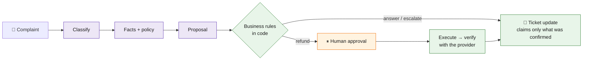

<div align="center">

# 🛟 Customer Support Resolution Agent

**An AI agent that takes a complaint from *"where is my refund?"* to a *verified* outcome,<br>and an evaluation platform that proves whether it deserves your trust.**


</div>

> **The one rule:** the model *proposes*. The application *decides* and executes, through controlled tools.
> No refund is ever issued without a human approval tied to one exact, immutable proposal.

## ✨ What it does



<sub>🟣 the model proposes · 🟢 ordinary code decides and executes · 🟠 a person approves</sub>

It handles three complaint types: **order status**, **refund request** and **damaged item**, for a fictional electronics store (one currency, INR in paise).

| 🔒 Built to be safe | How |
|---|---|
| **Identity** | Comes from the authenticated request. The model never picks the customer, reviewer, approval status or payment credentials. |
| **Ownership** | Checked inside every service: an order ID from the customer or the model grants nothing. |
| **Approval** | Bound to an immutable proposal and its hash. Chat text authorizes nothing. Expired or changed proposals need a fresh approval. |
| **No double refunds** | Stable idempotency key with a unique constraint, reserved balance under `SELECT … FOR UPDATE`, no transaction held during the network call. |
| **Lost responses** | If the provider accepts a refund but the reply is lost, the app asks the provider by key before retrying or telling the customer anything. Restarts reconcile first, then resume from checkpoints. |
| **Policies (RAG)** | Versioned, cited (`refund_policy_v1:section_3`), filtered by effective date. Retrieved text is untrusted, and a similarity score never proves eligibility. |

## 🚀 Try it in a few minutes

Needs Python 3.13, [uv](https://docs.astral.sh/uv/) and Docker. **No API key is needed** for the scripted run.

```bash
docker compose up -d postgres && docker compose --profile mocks up -d   # database + mock payment, shipping, ticketing
uv run python -m scripts.dev setup     # locked dependencies, .env, the support_eval database
uv run python -m scripts.dev migrate   # schemas
uv run python -m scripts.dev seed      # demo data, policies, dataset
uv run python -m scripts.dev smoke     # expect: 5  completed / pass
```

On Windows without `make`, use `uv run python -m scripts.dev <command>` as above (`make <command>` works too). For real-model runs, put a free Google AI Studio key in `LLM_API_KEY` and a model ID in `LLM_MODEL` (see `.env.example`). Embeddings are local (`all-MiniLM-L6-v2`), with no key.

## 📊 The evaluation platform

> *If I change the model, prompt, tools or orchestration, does the agent become more reliable, and at what cost?*

- **50 versioned tasks** (`support-v1`): dev 30 · validation 10 · held-out test 10. Each task has an *agent view* and a hidden *evaluator view*, so the agent never sees the answer key.
- **A clean world per attempt:** reset database and mocks, load the fixture, inject faults (5xx, delays, *"accept the refund, then time out"*), snapshot the final state.
- **Four deterministic evaluators** check the **business state**, not the wording: *outcome* · *policy* · *trajectory* · *response*. A blocked unsafe attempt is reported apart from an executed violation.
- **Honest metrics:** every number states its denominator, coverage sits next to success, missing token usage is *unknown* (never free), and automated resolutions are separate from human-assisted ones.
- **Comparisons and reports:** same-task wins and **regressed tasks**, with a saved manifest so any experiment can be rerun.
- **Screens:** `uvicorn evals.api:app --port 8100` → experiments, runs (agent input apart from ground truth), traces and comparisons.

| Config | Model | Design | Prompt |
|---|---|---|---|
| `lite_single_v1` | Gemini 3.5 Flash-Lite | single agent | v1 |
| `lite_specialist_v1` | Gemini 3.5 Flash-Lite | investigation · policy · resolution | v1 |
| `lite_specialist_v2` | Gemini 3.5 Flash-Lite | specialists | v2 |
| `flash_specialist_v1` | Gemini 3.5 Flash | specialists | v1 |

## 🎬 Demos

`uv run python -m scripts.dev demo a` … `e` (details in [docs/demo-scenarios.md](docs/demo-scenarios.md)):

| | Scenario | What it proves |
|---|---|---|
| **A** | ✅ Approved refund | complaint → evidence → reviewer approves → one provider refund → ticket resolved |
| **B** | 🚫 Blocked request | an ineligible refund is explained and no money moves |
| **C** | 🔁 Failure recovery | the provider accepts, the response is lost, the app reconciles: still one refund |
| **D** | 🎭 Convincing but wrong | "refund issued" while the provider holds none: the evaluators catch it *(scripted agent)* |
| **E** | ⚖️ Better prompt, a tradeoff | which tasks improved or regressed between prompt versions *(needs the real experiments)* |

## 📈 Results so far

Synthetic tasks against mock services; **not production performance.** Each row names its dataset, metric and sample.

| What | Dataset · split | Config | Result | Sample |
|---|---|---|---|---|
| Pilot, 2026-10-29 | `support-v1` · pilot | `lite_specialist_v1` | 5 of 5 scored: 4 pass, 1 partial; 6.4 model calls per run | 5 tasks × 1 |

The main experiment (150 runs), the repetitions and the model comparison are still running on the free-tier quota, and will be added here with their report files. Until then, this README makes **no claim** about which configuration is better.

## 🗺️ Learn more

| | |
|---|---|
| 🏗️ [Architecture diagrams](docs/diagrams/README.md) | 13 diagrams exported from [hld.md](hld.md) |
| 🎬 [Demo scenarios](docs/demo-scenarios.md) | how to run and present A to E |
| ✅ [Task list](tasks.md) | every task, decision and status |

<details>
<summary><b>⚙️ More commands and configuration</b></summary>

```bash
uv run uvicorn app.main:app --reload      # agent API: /health, /demo, /review
uv run python -m scripts.mint_token auth|alice   # demo JWT (--role reviewer|senior_reviewer|operator)
uv run python -m app.jobs.worker          # worker for RUN_EXECUTION=worker (202 Accepted + polling)
uv run python -m scripts.recover          # reconcile uncertain refunds, resume unfinished runs
uv run python -m scripts.dev test         # the deterministic suite (no model calls)
uv run python -m scripts.dev evaluate --plan pilot   # a real-model experiment (uses free-tier quota)
uv run python -m scripts.dev report <experiment_id>  # export JSON + CSV
uv run python -m scripts.export_diagrams --render    # diagrams from hld.md
```

- Two databases on purpose: `support` (the app) and `support_eval` (experiments; every attempt empties business tables). The eval commands always target `support_eval`, and the worker refuses any database not named `*_eval` or `*_test`.
- `RUN_EXECUTION=inline` drives a run inside the request; `worker` returns `202` and a worker drives it. Approvals expire after `APPROVAL_EXPIRY_MINUTES` (60).
- Money is stored as integer minor units. The mock clients use `PROVIDER_TIMEOUT_SECONDS` (5), so timeout faults really time out.

</details>

<details>
<summary><b>⚠️ Limitations and scope</b></summary>

- One fictional store, one currency, 50 hand-written tasks and mock providers: it says nothing about real traffic.
- The scripted agent is a platform test double, not a model, and it does not retrieve policy.
- One attempt at a time per environment, and large runs depend on the free-tier quota.
- Approvals are simulated in evaluations; deterministic evaluators only (no LLM judge, no public benchmarks yet).
- Cost is an estimate from price versions; the free-tier cost is zero.
- Demo C simulates the restart; the real mid-flight kill is covered by a failure-scenario test.
- Out of scope: chargebacks, fraud adjudication, complex partial returns, messaging outside the demo screens.

</details>

<div align="center"><sub>Phase 0 and Weeks 1–4 done · Week 5 in progress (experiments running, recording to come)</sub></div>
