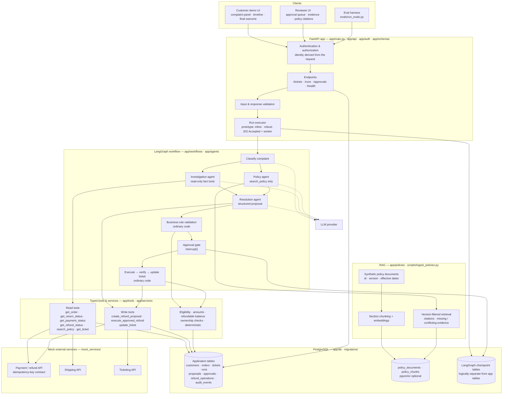
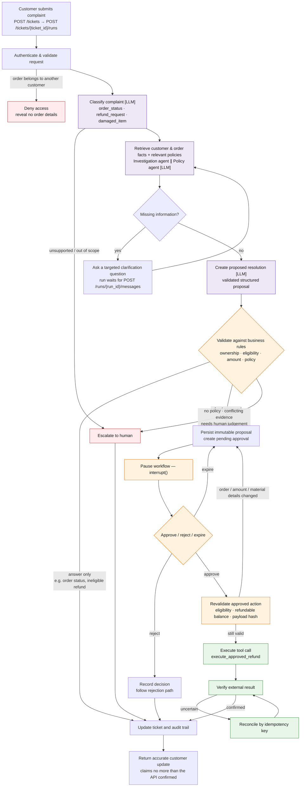
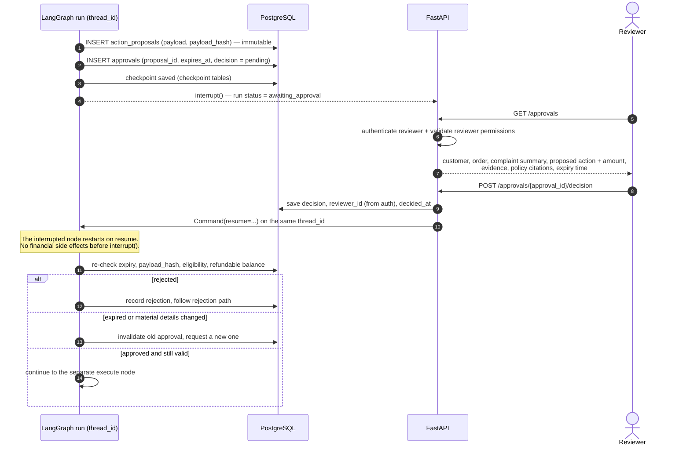
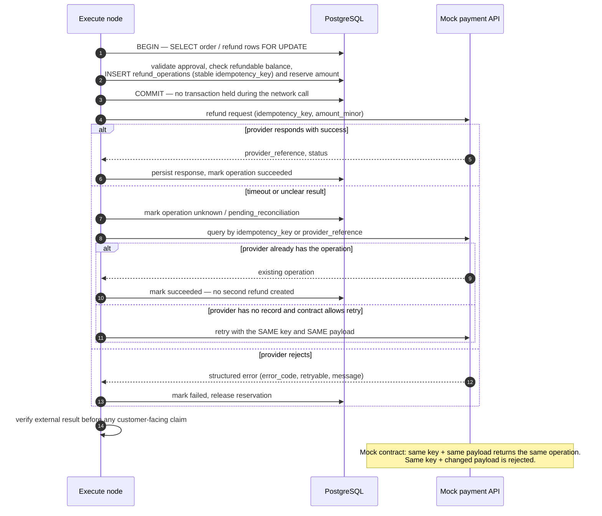
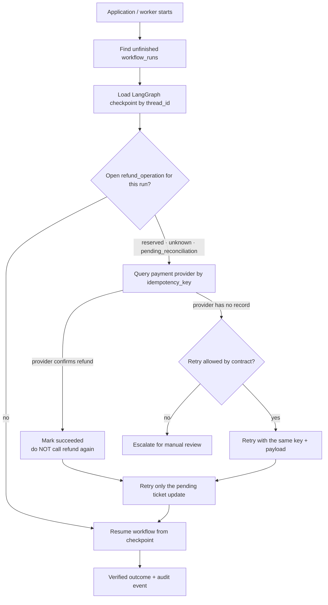
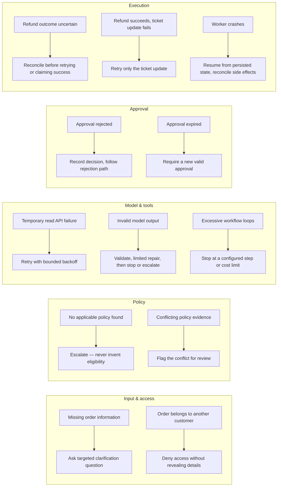
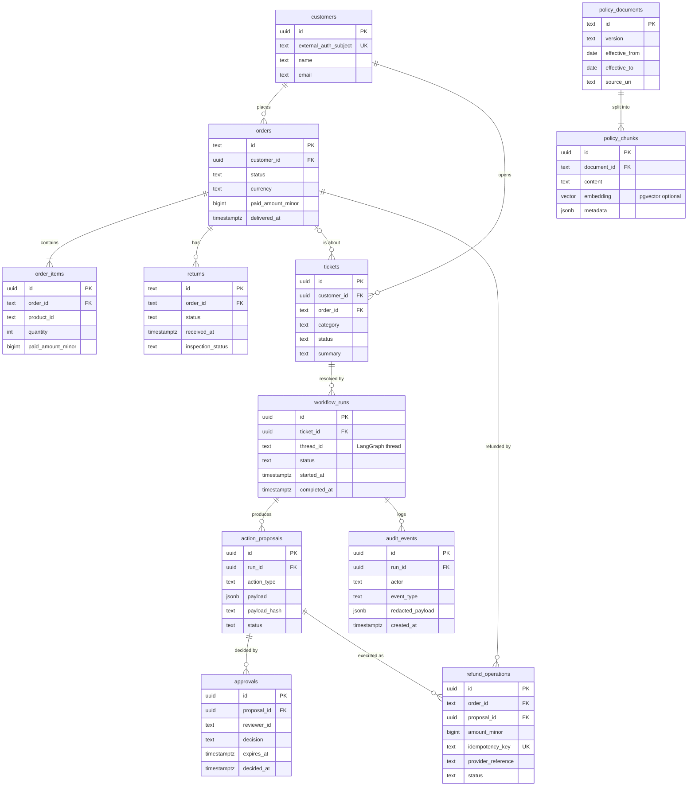
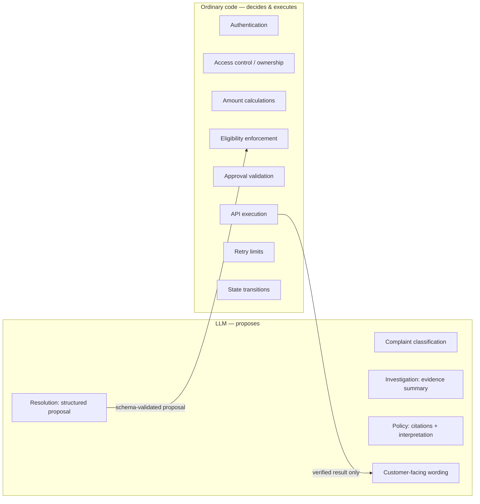

# High-Level Architecture — Customer Support Resolution Agent

Source: `Project.pdf`, *"A practical Agentic AI project for aspiring Forward Deployed Engineers"*.
Stack: **Python · LangGraph · FastAPI · PostgreSQL** (pgvector optional). All customer data is synthetic and every external service is mocked.

> **Core rule (PDF §4):** the model *proposes* actions. The application decides whether they are permitted and executes them through controlled tools.

Diagrams in this file:

1. [System architecture](#1-system-architecture)
2. [Resolution workflow (LangGraph)](#2-resolution-workflow-langgraph)
3. [Human approval: pause / resume](#3-human-approval--pause--resume)
4. [Refund execution, verification and reconciliation](#4-refund-execution-verification-and-reconciliation)
5. [Failure recovery](#5-failure-recovery)
6. [Database schema](#6-database-schema)
7. [API endpoints → components](#7-api-endpoints--components)
8. [LLM vs ordinary code boundary](#8-llm-vs-ordinary-code-boundary)
9. [Components → repository structure](#9-components--repository-structure)

---

## 1. System architecture

Four main components (PDF §5): **FastAPI app**, **LangGraph workflow**, **PostgreSQL**, and **mock external services**. RAG over support policies sits on top of PostgreSQL.



Notes:

- **Identity comes from the authenticated request.** The model never picks which customer it acts for, and it never supplies reviewer identity, approval status or payment credentials (PDF §8).
- **Least privilege per agent.** The investigation agent has no refund-execution tool. Write tools are reachable only through the resolution proposal step and the code-owned execute step (PDF §6).
- **The checkpoint is not the financial ledger.** Refund accounting lives in application tables, with explicit constraints and transactions (PDF §7).
- **Mock services can return errors and delayed results**, so realistic failures can be tested (PDF §5).

---

## 2. Resolution workflow (LangGraph)

This is the PDF §4 foundation flow, with branches for the three supported complaint types (order status, refund request, damaged item). Nodes marked **[LLM]** use the model. Everything else is ordinary code.



Per complaint type (PDF §3):

| Complaint | Typical path |
|---|---|
| **A. Order status** | facts (order + shipment) → answer only → update ticket |
| **B. Refund request** | facts + refund policy → proposal → approval → execute → verify → update ticket |
| **C. Damaged item** | facts + damaged-product policy → collect required info → resolution proposal **or** escalate |

First-version limits: one store, one currency, **human approval for every refund**, one customer issue per workflow, and no chargebacks, fraud adjudication or complex partial returns.

---

## 3. Human approval — pause / resume

PDF §11. The approval is tied to one **exact, immutable proposal**. An approval message in chat does not authorize anything: the execution service checks the stored approval and the authenticated reviewer's decision.



---

## 4. Refund execution, verification and reconciliation

PDF §12. The hard test case: *the payment service accepts the refund, but the app times out before it gets the response.* Retrying blindly with a new request would create a duplicate refund.



Ledger rules (PDF §7):

- Money is stored as **integer minor units** (paise / cents).
- `refund_operations.idempotency_key` has a **unique constraint**.
- Successful refunds **plus** amounts reserved by pending operations can never exceed the refundable balance.
- Concurrent requests are serialized with `SELECT ... FOR UPDATE` or equivalent.
- A checkpoint alone does not guarantee that an external action happens exactly once.

---

## 5. Failure recovery

### 5a. Worker crash / application restart



### 5b. Failure → expected behavior (PDF §14)



---

## 6. Database schema

The tables and "important fields" are exactly the PDF §7 suggested schema. Column types are a suggested mapping only. Application tables are kept **logically separate** from LangGraph checkpoint tables.



There is no `payments` table in the PDF schema. Payment and refund status are read from the **mock payment API** (`get_payment_status`, `get_refund_status`).

---

## 7. API endpoints → components

Suggested endpoints, exactly as in PDF §13. Authorization is checked on **every** endpoint.

| Endpoint | Purpose | Caller | Touches |
|---|---|---|---|
| `POST /tickets` | Create a customer support ticket | Customer | `tickets` |
| `POST /tickets/{ticket_id}/runs` | Start a resolution workflow | Customer / system | `workflow_runs`, LangGraph |
| `GET /runs/{run_id}` | Retrieve status and output | Customer / reviewer | `workflow_runs`, checkpoint |
| `GET /runs/{run_id}/events` | Retrieve a redacted event timeline | Customer / reviewer | `audit_events` |
| `GET /approvals` | List approvals available to the reviewer | Reviewer | `approvals`, `action_proposals` |
| `POST /approvals/{approval_id}/decision` | Approve or reject a proposal | Reviewer | `approvals` → `Command(resume=...)` |
| `POST /runs/{run_id}/messages` | Supply additional customer information | Customer | resumes the clarification wait |
| `GET /health` | Check application health | Ops | DB + mocks |

Execution approach: the **prototype** runs short workflows inline and returns when they finish or pause. The **robust version** persists a job, returns `202 Accepted` with the run ID, executes on a worker (FastAPI `BackgroundTasks` or Celery), persists progress, and lets clients poll status.

---

## 8. LLM vs ordinary code boundary



| Agent | Responsibility | Output | Tools allowed |
|---|---|---|---|
| Investigation agent | Gather customer, order, return and payment facts | Structured evidence summary | read tools only — **no refund execution** |
| Policy agent | Retrieve applicable policy passages | Citations and policy interpretation | `search_policy` |
| Resolution agent | Combine facts and policy into a proposed action | Structured resolution proposal | `create_refund_proposal` (proposal only, moves no money) |

Investigation and policy retrieval run **concurrently** when they are independent. If policy selection depends on the product or order date, facts are gathered first. A **single-agent baseline** is built first and compared against this specialist design (PDF §6).

---

## 9. Components → repository structure

Repository layout as in PDF §17:

```text
customer-support-resolution-agent/
├── app/
│   ├── main.py            # FastAPI entrypoint
│   ├── api/               # endpoints (§7 table above)
│   ├── auth/              # customer + reviewer authentication / authorization
│   ├── schemas/           # validated I/O + specialist output schemas
│   ├── agents/            # investigation · policy · resolution
│   ├── workflows/         # LangGraph graph, state, routing, interrupt/resume
│   ├── tools/             # typed read / write tools
│   ├── services/          # eligibility, refunds, reconciliation, tickets, audit
│   ├── policies/          # policy retrieval (RAG)
│   └── db/                # models, sessions, checkpointer config
├── mock_services/
│   ├── payments/          # refund API with idempotency contract + fault injection
│   └── shipping/          # shipment status + fault injection
├── migrations/
├── scripts/
│   ├── seed_data.py
│   └── ingest_policies.py
├── evals/
│   ├── datasets/
│   ├── run_evals.py
│   └── reports/
├── tests/
│   ├── unit/
│   ├── integration/
│   └── failure_scenarios/
├── docs/
├── docker-compose.yml
├── .env.example
├── pyproject.toml
└── README.md
```

The PDF lists a **ticketing API** among the mock services (§5), but its repository tree only has `payments/` and `shipping/` under `mock_services/`. See the open question in [`tasks.md`](tasks.md).
