# High-Level Architecture — Customer Support Resolution Agent

Sources:

- `Project.pdf`, *"A practical Agentic AI project for aspiring Forward Deployed Engineers"*: the resolution agent (§1–§9 of this file, cited as `PDF §n`).
- `Project_2.pdf`, *"A complete project guide for engineering students and aspiring Forward Deployed Engineers"*: the evaluation platform (§10, cited as `E§n`). Merged on 2026-10-27 in a scoped form; the resolution agent is the system it evaluates.

Stack: **Python · LangGraph · FastAPI · PostgreSQL** (pgvector optional). All customer data is synthetic and every external service is mocked.

> **Core rule (PDF §4):** the model *proposes* actions. The application decides whether they are permitted and executes them through controlled tools.
>
> **Evaluation rule (E§1):** an agent's final message is evidence to inspect, not proof that the task succeeded.

Diagrams in this file:

- [High-Level Architecture — Customer Support Resolution Agent](#high-level-architecture--customer-support-resolution-agent)
  - [1. System architecture](#1-system-architecture)
  - [2. Resolution workflow (LangGraph)](#2-resolution-workflow-langgraph)
  - [3. Human approval — pause / resume](#3-human-approval--pause--resume)
  - [4. Refund execution, verification and reconciliation](#4-refund-execution-verification-and-reconciliation)
  - [5. Failure recovery](#5-failure-recovery)
    - [5a. Worker crash / application restart](#5a-worker-crash--application-restart)
    - [5b. Failure → expected behavior (PDF §14)](#5b-failure--expected-behavior-pdf-14)
  - [6. Database schema](#6-database-schema)
  - [7. API endpoints → components](#7-api-endpoints--components)
  - [8. LLM vs ordinary code boundary](#8-llm-vs-ordinary-code-boundary)
  - [9. Components → repository structure](#9-components--repository-structure)
  - [10. Evaluation platform](#10-evaluation-platform)
    - [10a. Components](#10a-components)
    - [10b. One evaluation attempt](#10b-one-evaluation-attempt)
    - [10c. Agent-visible vs evaluator-visible data](#10c-agent-visible-vs-evaluator-visible-data)
    - [10d. `eval` schema](#10d-eval-schema)
    - [10e. Execution and evaluation states](#10e-execution-and-evaluation-states)

---

## 1. System architecture

Four main components (PDF §5): **FastAPI app**, **LangGraph workflow**, **PostgreSQL**, and **mock external services**. RAG over support policies sits on top of PostgreSQL.

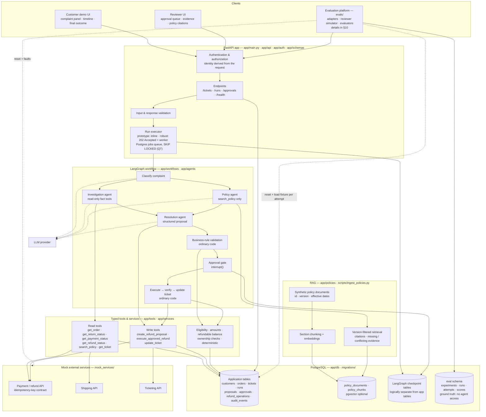

Notes:

- **Identity comes from the authenticated request.** The model never picks which customer it acts for, and it never supplies reviewer identity, approval status or payment credentials (PDF §8).
- **Least privilege per agent.** The investigation agent has no refund-execution tool. Write tools are reachable only through the resolution proposal step and the code-owned execute step (PDF §6).
- **The checkpoint is not the financial ledger.** Refund accounting lives in application tables, with explicit constraints and transactions (PDF §7).
- **Mock services can return errors and delayed results**, so realistic failures can be tested (PDF §5).
- **The evaluation platform drives the agent like a client.** It creates tickets and starts runs through the same API and tools, so every safety check applies to it too. Only the platform reads the `eval` schema (§10).

---

## 2. Resolution workflow (LangGraph)

This is the PDF §4 foundation flow, with branches for the three supported complaint types (order status, refund request, damaged item). Nodes marked **[LLM]** use the model. Everything else is ordinary code.

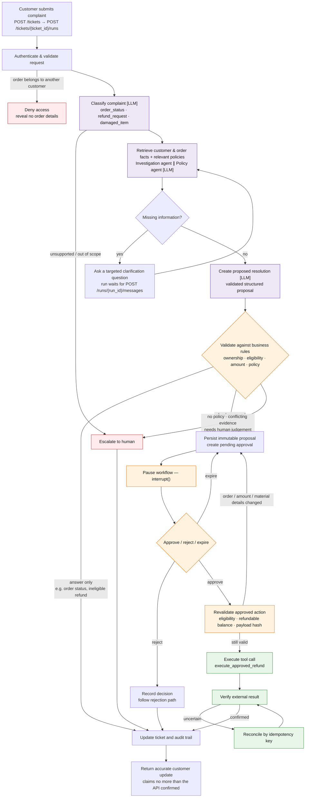

Per complaint type (PDF §3):

| Complaint | Typical path |
|---|---|
| **A. Order status** | facts (order + shipment) → answer only → update ticket |
| **B. Refund request** | facts + refund policy → proposal → approval → execute → verify → update ticket |
| **C. Damaged item** | facts + damaged-product policy → collect required info → resolution proposal **or** escalate |

First-version limits: one store, one currency, **human approval for every refund**, one customer issue per workflow, and no chargebacks, fraud adjudication or complex partial returns.

---

## 3. Human approval — pause / resume

PDF §11. The approval is tied to one **exact, immutable proposal**. An approval message in chat does not authorize anything: the execution service checks the stored approval and the authenticated reviewer's decision.

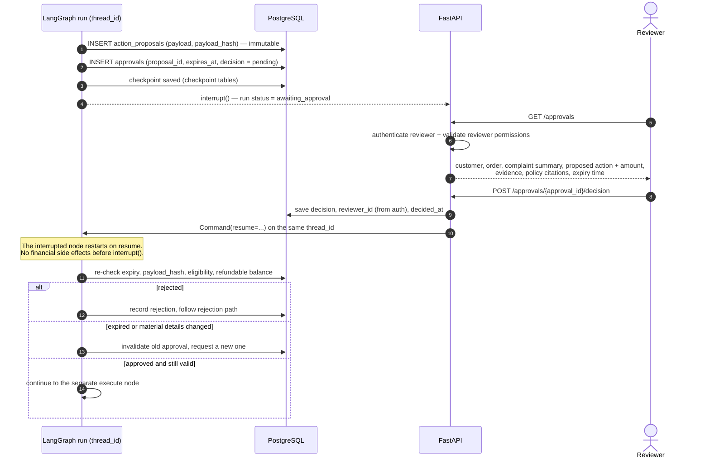

---

## 4. Refund execution, verification and reconciliation

PDF §12. The hard test case: *the payment service accepts the refund, but the app times out before it gets the response.* Retrying blindly with a new request would create a duplicate refund.

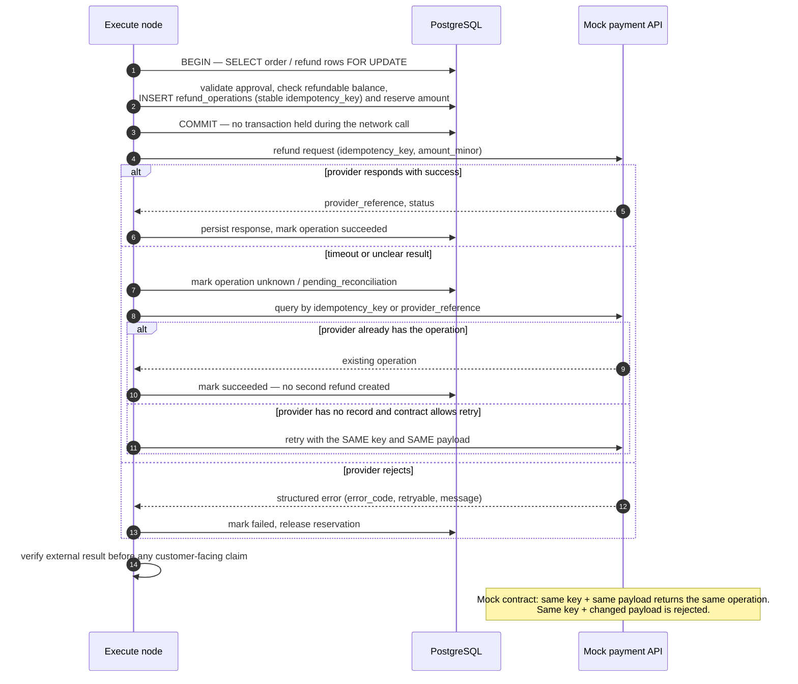

Ledger rules (PDF §7):

- Money is stored as **integer minor units** (paise / cents).
- `refund_operations.idempotency_key` has a **unique constraint**.
- Successful refunds **plus** amounts reserved by pending operations can never exceed the refundable balance.
- Concurrent requests are serialized with `SELECT ... FOR UPDATE` or equivalent.
- A checkpoint alone does not guarantee that an external action happens exactly once.

---

## 5. Failure recovery

### 5a. Worker crash / application restart

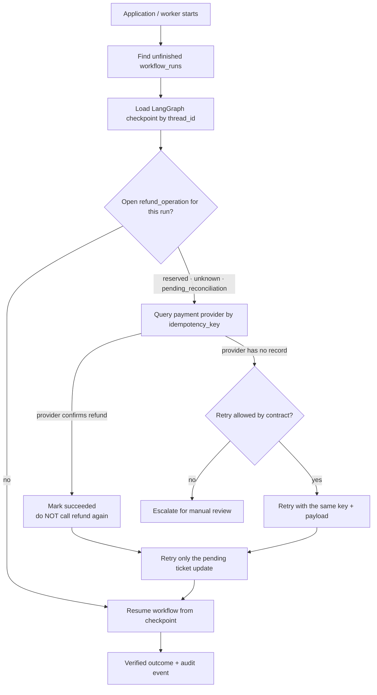

### 5b. Failure → expected behavior (PDF §14)

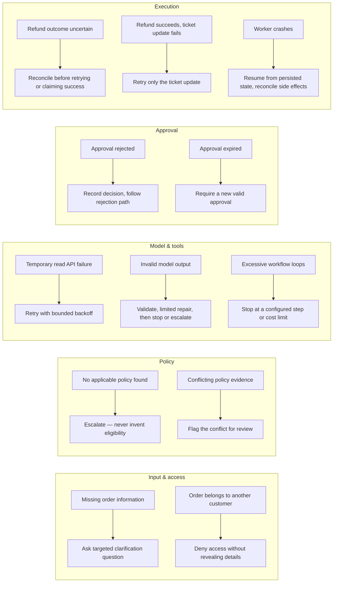

---

## 6. Database schema

The tables and "important fields" are exactly the PDF §7 suggested schema. Column types are a suggested mapping only. Application tables are kept **logically separate** from LangGraph checkpoint tables.


There is no `payments` table in the PDF schema. Payment and refund status are read from the **mock payment API** (`get_payment_status`, `get_refund_status`).

Additions beyond the PDF §7 schema (all in the `support` schema, added by later migrations):

| Addition | Task | Purpose |
|---|---|---|
| `jobs` table | W3.13 (Q7) | Postgres job queue: `job_type` (`workflow_run` · `eval_attempt`), `payload`, `status`, `available_at`, `attempts`, `worker_id`, `lease_token`, `lease_expires_at` |
| `audit_events.sequence_number` | W3.15 | Per-run event order, unique per run, so the evaluation platform can replay a trace exactly |
| `model_call` · `tool_requested` · `tool_rejected` · `tool_finished` · `agent_finished` event types | W2.16, W3.15 | Token usage, latency, blocked attempts vs executed effects, stop reason |

The evaluation platform's own tables live in a separate `eval` schema (§10d).

---

## 7. API endpoints → components

Suggested endpoints, exactly as in PDF §13. Authorization is checked on **every** endpoint.

| Endpoint | Purpose | Caller | Touches |
|---|---|---|---|
| `POST /tickets` | Create a customer support ticket | Customer | `tickets` |
| `POST /tickets/{ticket_id}/runs` | Start a resolution workflow | Customer / system | `workflow_runs`, LangGraph |
| `GET /runs/{run_id}` | Retrieve status and output | Customer / reviewer | `workflow_runs`, checkpoint |
| `GET /runs/{run_id}/events` | Retrieve a redacted event timeline | Customer / reviewer | `audit_events` |
| `GET /approvals` | List approvals available to the reviewer | Reviewer | `approvals`, `action_proposals` |
| `POST /approvals/{approval_id}/decision` | Approve or reject a proposal | Reviewer | `approvals` → `Command(resume=...)` |
| `POST /runs/{run_id}/messages` | Supply additional customer information | Customer | resumes the clarification wait |
| `GET /health` | Check application health | Ops | DB + mocks |

Execution approach: the **prototype** runs short workflows inline and returns when they finish or pause. The **robust version** persists a job, returns `202 Accepted` with the run ID, executes on a separate worker process that claims jobs from the Postgres `jobs` table with `SELECT ... FOR UPDATE SKIP LOCKED` (Q7, W3.13), persists progress, and lets clients poll status.

Evaluation endpoints (E§24, W5.4). All sit under `/eval` so they never collide with the agent's `/runs` endpoints, and only the `operator` role may call them (Q12):

| Endpoint | Purpose | Touches |
|---|---|---|
| `POST /eval/datasets/import` · `GET /eval/datasets` | Validate and import a dataset version; list them | `eval.datasets`, `dataset_versions`, `task_versions` |
| `POST /eval/agent-configs` · `GET /eval/agent-configs` | Register an immutable configuration; list them | `eval.agent_configs`, `prompt_versions` |
| `POST /eval/experiments` | Create experiment, runs and jobs in one transaction (`Idempotency-Key`) | `eval.experiments`, `eval.runs`, `support.jobs` |
| `GET /eval/experiments/{id}` | Progress and scorecard | `eval.runs`, `eval.scores` |
| `GET /eval/experiments/{id}/runs` | Paginated runs with filters | `eval.runs` |
| `POST /eval/experiments/{id}/cancel` | Request cancellation | `eval.experiments`, `support.jobs` |
| `GET /eval/runs/{id}` | Outcome, attempts, scores | `eval.runs`, `attempts`, `scores` |
| `GET /eval/attempts/{id}/events` | Ordered trace | `eval.trace_events` |
| `POST /eval/comparisons` | Compare compatible experiments | `eval.*` |
| `GET /eval/experiments/{id}/export` | Download the JSON / CSV report | `eval.artifacts` |

---

## 8. LLM vs ordinary code boundary

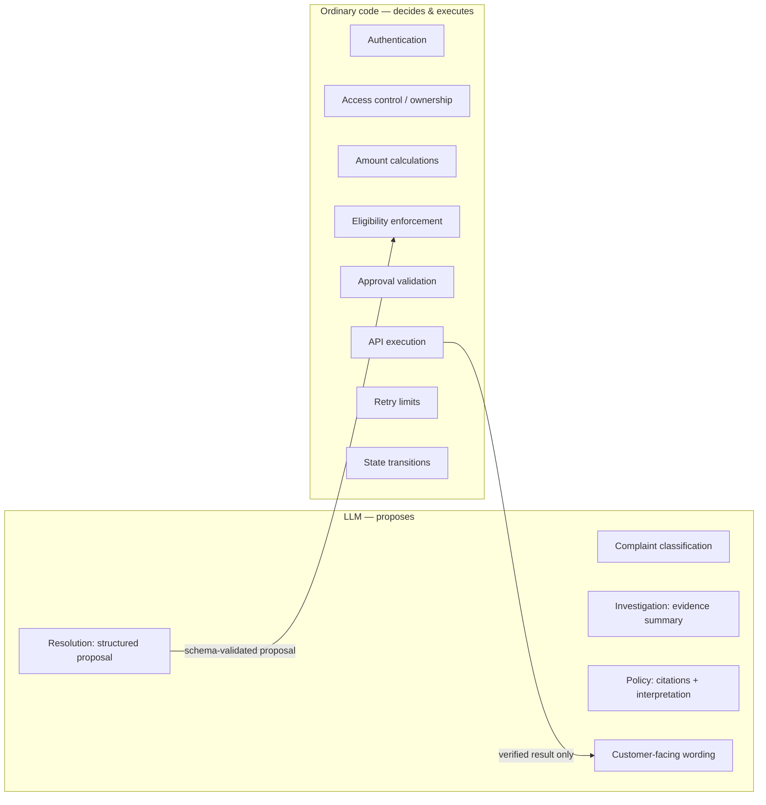

| Agent | Responsibility | Output | Tools allowed |
|---|---|---|---|
| Investigation agent | Gather customer, order, return and payment facts | Structured evidence summary | read tools only — **no refund execution** |
| Policy agent | Retrieve applicable policy passages | Citations and policy interpretation | `search_policy` |
| Resolution agent | Combine facts and policy into a proposed action | Structured resolution proposal | `create_refund_proposal` (proposal only, moves no money) |

Investigation and policy retrieval run **concurrently** when they are independent. If policy selection depends on the product or order date, facts are gathered first. A **single-agent baseline** is built first and compared against this specialist design (PDF §6).

---

## 9. Components → repository structure

Repository layout as in PDF §17:

```text
customer-support-resolution-agent/
├── app/
│   ├── main.py            # FastAPI entrypoint
│   ├── api/               # endpoints (§7 table above)
│   ├── auth/              # customer + reviewer authentication / authorization
│   ├── schemas/           # validated I/O + specialist output schemas
│   ├── agents/            # investigation · policy · resolution
│   ├── workflows/         # LangGraph graph, state, routing, interrupt/resume
│   ├── tools/             # typed read / write tools
│   ├── services/          # eligibility, refunds, reconciliation, tickets, audit
│   ├── policies/          # policy retrieval (RAG)
│   └── db/                # models, sessions, checkpointer config
├── mock_services/
│   ├── payments/          # refund API with idempotency contract + fault injection
│   ├── shipping/          # shipment status + fault injection
│   └── ticketing/         # ticket status + notes updates + fault injection (Q1)
├── migrations/
├── scripts/
│   ├── seed_data.py
│   └── ingest_policies.py
├── evals/                 # evaluation platform (§10); app/ never imports from here
│   ├── datasets/
│   │   └── support-v1/
│   │       ├── tasks/     # one YAML per task: agent view + evaluator view
│   │       └── splits/    # dev · validation · test · pilot manifests
│   ├── adapters/          # base.py (AgentAdapter) · scripted.py · langgraph.py
│   ├── evaluators/        # outcome · policy · trajectory · response
│   ├── environment.py     # per-attempt reset, fixture loading, snapshots
│   ├── reviewer.py        # deterministic reviewer simulator
│   ├── run_evals.py       # create an experiment from a manifest
│   └── reports/           # exported JSON / CSV per experiment
├── tests/
│   ├── unit/
│   ├── integration/
│   ├── failure_scenarios/
│   └── evals/             # evaluator, isolation, worker and accounting tests
├── docs/
├── Makefile               # setup · migrate · seed · test · smoke · evaluate · report
├── docker-compose.yml     # + worker service (W3.13)
├── .env.example
├── pyproject.toml
└── README.md
```

The PDF lists a **ticketing API** among the mock services (§5), but its repository tree only has `payments/` and `shipping/` under `mock_services/`. **Decided (Q1 in [`tasks.md`](tasks.md), 2026-10-24):** the ticketing API is a separate mock service in `mock_services/ticketing/` (port 8003). The app's `tickets` table stays the local record, and its status changes only after the ticketing API confirms.

The `evals/` subfolders, `tests/evals/` and the `Makefile` come from `Project_2.pdf` (E§26, E§30), adapted to this repository instead of its separate `agent-evaluation-platform/` layout.

---

## 10. Evaluation platform

`Project_2.pdf`, scoped (Weeks 4–5 in [`tasks.md`](tasks.md)). It answers one question (E§1): *"If I change the agent's model, prompt, tools or orchestration, does it become more reliable, and at what cost?"* The resolution agent from §1–§9 is the system under test.

Objects, used consistently (E§4):

| Object | Meaning |
|---|---|
| Task | One problem with initial conditions and success criteria (a YAML file) |
| Dataset version | An immutable collection of task versions (`support-v1`) |
| Agent configuration | A fixed combination of model, prompt, architecture and limits |
| Experiment | A planned evaluation of configurations against a dataset split |
| Run | One configuration × one task × one repetition |
| Attempt | A concrete execution of a run; an infrastructure retry is a new attempt |
| Trace | The ordered events of an attempt: model calls, tool requests and results, decisions |
| Evaluator | Deterministic code that scores one property |
| Score | An evaluator's result, with evidence and applicability |
| Artifact | A final-state snapshot or an exported report |

Scope (decided 2026-10-27): one custom dataset of 50 tasks, deterministic evaluators only, simulated approvals, one attempt at a time. Public benchmarks, an LLM judge, simulated multi-turn users and concurrent attempts are extensions.

### 10a. Components

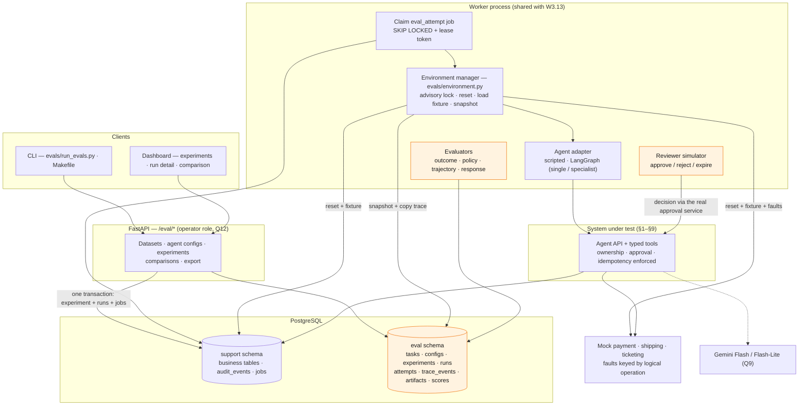

Notes:

- **The agent is driven like any client.** The LangGraph adapter creates a ticket under the task customer's JWT and starts a run. The scripted adapter calls the same typed tools. So the platform tests the real enforcement, not a shortcut around it.
- **One worker, two job types.** `workflow_run` (W3.13) and `eval_attempt` (W4.8) share the queue, leases and recovery.
- **Orange components see hidden data.** Nothing on the agent side reads the `eval` schema.

### 10b. One evaluation attempt

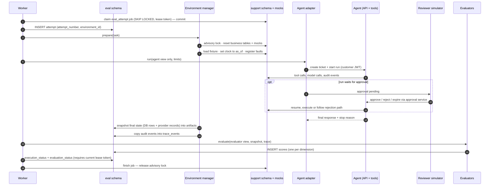

If the worker dies mid-attempt, the lease expires, the sweep requeues the job, and a **new attempt with a fresh environment** runs. The stale worker cannot finalize because its lease token is no longer current. Agent behavior failures are scored and never retried (E§17).

### 10c. Agent-visible vs evaluator-visible data

E§5, E§8: the agent and the evaluators share one codebase but have different access paths and data views.

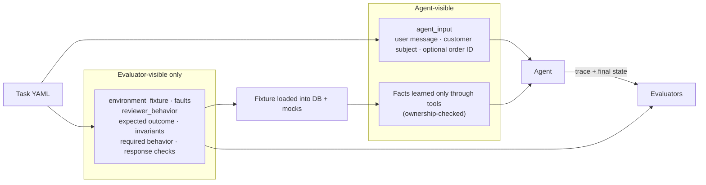

The worker loads the full fixture, but the agent receives only `agent_input`; it learns order facts by calling tools. A test proves the agent view never contains fixture, reviewer or evaluation keys (W4.1).

Evaluators (E§14):

| Evaluator | Reads | Checks |
|---|---|---|
| Outcome | Final-state snapshot | Correct order and amount, exactly one financial effect, ticket consistent, approval requested when required, or the expected non-action |
| Policy | Trace | No cross-customer access, no refund without approval, no over-refund, no forbidden effect; **unsafe attempts and executed violations counted separately** |
| Trajectory | Trace | Tool choice, schema validity, arguments, partial-order preconditions, redundancy, handling of injected faults |
| Response | Final message + snapshot | The message claims nothing the state does not confirm |

**Verified success** = required outcome **and** no hard invariant violated **and** required response checks pass (E§20).

### 10d. `eval` schema

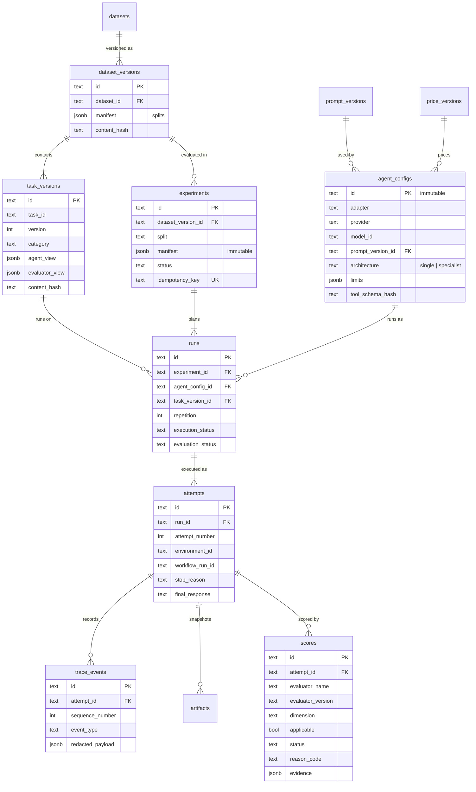

Constraints (E§16): `UNIQUE(experiment_id, agent_config_id, task_version_id, repetition)`, `UNIQUE(run_id, attempt_number)`, `UNIQUE(attempt_id, sequence_number)`, `UNIQUE(attempt_id, evaluator_name, evaluator_version, dimension)`. Traces and snapshots are **copied** into `eval` because the next attempt resets the `support` business tables (Q8, Q11).

### 10e. Execution and evaluation states

E§18: execution status and evaluation outcome are tracked separately.

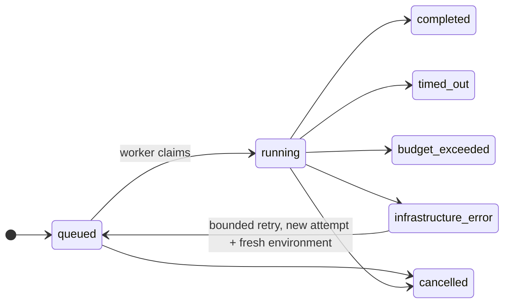

| Execution status | Evaluation status | Example |
|---|---|---|
| `completed` | `pass` | Correct approved refund, or a correct refusal |
| `completed` | `fail` | Confident final message, wrong result |
| `completed` | `fail` (stop reason `max_steps`) | Hit the turn limit |
| `infrastructure_error` | `pending` | Model provider unreachable after retries |
| any | `evaluation_error` | An evaluator raised; never a silent pass or agent failure |
| any | `not_applicable` | Per dimension, e.g. trajectory scores for a task needing no tools |

Metrics are computed from these states with explicit denominators (verified success, strict end-to-end success, coverage, unsafe attempt rate, executed violation rate, tool precision and recall, latency, tokens and estimated cost). Full definitions: W5.1 in [`tasks.md`](tasks.md).
